# Ocean Surf

A sea and surf look for the Claude desktop app (Code tab).

- **Colors**: an ocean palette for both light and dark mode, with sea-mist surfaces by day and deep-ocean blues by night.
- **Backdrop**: an animated beach behind the conversation. Slow waves roll in, a surfer rides them, foam washes over the sand and dune grass sways in the wind.
- **Real sun**: the scene follows the sun where you are. It shows daytime, a golden hour around sunrise and sunset, and a moonlit night (the surfer goes home and the board stays planted in the sand).

| Day | Golden hour | Night |
| --- | --- | --- |
|  |  |  |

## Install

At the prompt of a Claude Code terminal session:

```
/plugin install ocean-surf --marketplace Briac-alt/ocean-surf
```

From a shell:

```bash
claude plugin install ocean-surf --marketplace Briac-alt/ocean-surf
```

In the desktop app, where `/plugin` does not run: click **+** next to the prompt box, then **Plugins**, **Add marketplace** with `Briac-alt/ocean-surf`, then **Add plugin**.

New sessions pick it up. In a session that is already open, run `/reload-plugins`.

## Set your location

The sun is computed for Paris unless you set your own latitude and longitude (degrees; west and south are negative). For example, for Lisbon:

```bash
echo '{"latitude":"38.72","longitude":"-9.14"}' | claude plugin configure ocean-surf@ocean-surf --values-stdin
```

Or run `/plugin configure ocean-surf` in a Claude Code terminal session. Restart or open a new session to apply it.

## Good to know

- The look draws in the desktop and mobile apps. The terminal and editors draw no theme.
- The interface colors follow your light or dark mode. The backdrop follows the sun.
- If you asked your system for reduced motion, the scene stays still.
- The scene is pure SVG with CSS animation: no images, fonts or network calls.

## Uninstall

```bash
claude plugin uninstall ocean-surf
```

## License

MIT
